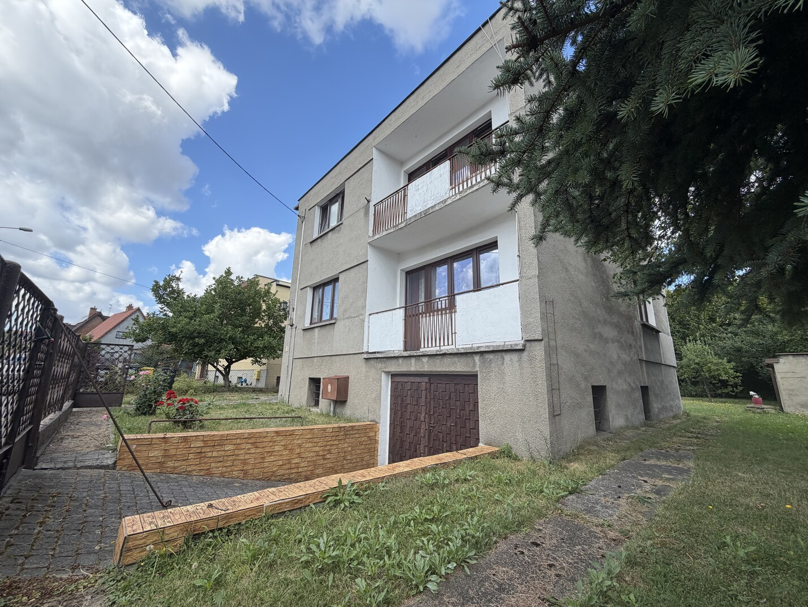

# Dom na sprzedaż · Zabrze

> ## [Zobacz pełne ogłoszenie na GitHub Pages →](https://rochowiaka10.github.io/rochowiaka10/)

**ul. Stanisława Rochowiaka 10, Zabrze**  
Sprzedaż bezpośrednio od właściciela — bez pośredników.

## Najważniejsze informacje

| Parametr | Informacja |
| --- | --- |
| Typ nieruchomości | Dom wolnostojący |
| Powierzchnia domu | 110 m² |
| Powierzchnia działki | 723 m² |
| Liczba pokoi | 6 |
| Łazienki | 2 — po jednej na każdym piętrze |
| Stan budynku | Do remontu |
| Ogrzewanie | Gazowe |
| Materiał budowy | Cegła |
| Okna | Plastikowe |
| Dodatkowo | Balkon, piwnica, garaż na dwa samochody |

## O nieruchomości

Na sprzedaż przestronny dom wolnostojący z dużą działką, garażem na dwa samochody i budynkiem gospodarczym. Nieruchomość znajduje się w Zabrzu i łączy dużą przestrzeń z potencjałem do własnej aranżacji.

Dom oferuje sześć ustawnych pokoi, dzięki czemu dobrze sprawdzi się dla większej rodziny lub osób potrzebujących dodatkowego miejsca do pracy. Na każdym z dwóch pięter znajduje się łazienka, co podnosi komfort codziennego użytkowania. Dodatkowymi atutami są duży przedpokój, balkon oraz ogrzewanie gazowe.

Budynek jest w stanie do remontu, co daje nowemu właścicielowi możliwość urządzenia go zgodnie z własnymi potrzebami.

## Najważniejsze atuty

- 6 przestronnych pokoi,
- 2 łazienki — po jednej na każdym piętrze,
- duży przedpokój,
- balkon,
- ogrzewanie gazowe,
- działka o powierzchni 723 m² z ogrodem,
- garaż na dwa samochody,
- budynek gospodarczy za domem — odpowiedni na warsztat, magazyn lub pracownię,
- przestronna piwnica z dużą ilością miejsca do przechowywania,
- spokojna i cicha okolica.

## Lokalizacja

W pobliżu znajdują się sklepy, szkoły, przedszkola oraz przystanki komunikacji miejskiej. Najważniejsze punkty codziennej infrastruktury są dostępne w zasięgu kilku minut.

Nieruchomość będzie dobrym wyborem zarówno dla rodzin z dziećmi, jak i osób ceniących przestrzeń, funkcjonalność oraz wygodny dostęp do miejskiej infrastruktury.

## Sprzedaż bezpośrednia

Zakup bezpośrednio od właściciela, bez pośredników. Cena wynosi **895 000 PLN** i podlega negocjacji.

Zapraszam do kontaktu w celu uzyskania dodatkowych informacji i umówienia prezentacji nieruchomości.

## Kontakt

- Telefon: [889-359-147](tel:+48889359147)
- E-mail: [rochowiaka10@gmail.com](mailto:rochowiaka10@gmail.com)
